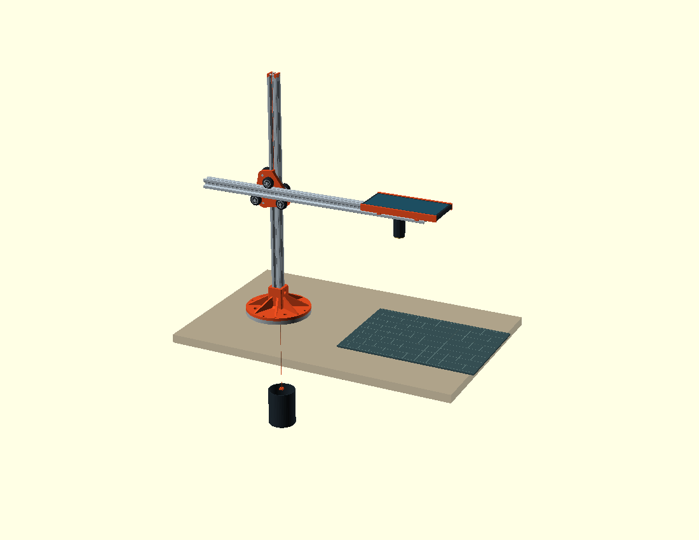

# XYZ Arm

A counterbalanced desk arm that holds a phone camera over a bench. A vertical 2020 V-slot spine on a turntable bearing carries a horizontal 2020 gantry on a printed wheel plate. A braided line over a pulley at the top of the spine runs down to a stack of steel washers behind it, so the gantry floats and stays where you leave it, the way a Dyson CSYS lamp does. The phone hangs at the end of the gantry looking straight down at a calibration mat.

It was built to give [DeskCam](captures/README.md), a phone-as-bench-camera tool, a repeatable overhead view: photographing prints, boards and parts, and measuring them off the mat's own scale.



The render above is the early concept assembly. The counterweight has since moved from a pot under the desk to a washer stack behind the spine, and the round base sits on a V of two rails. See the [design log](cad/README.md) for where each part stands.

## Status

Built and in use, still changing. As of 2026-09-27:

| Area | Part | State |
|---|---|---|
| Base | [`v-base.scad`](cad/parts/v-base.scad), [`z-base.scad`](cad/parts/z-base.scad) (fins) | Printed, on the desk |
| Carriage | [`compact-carriage.scad`](cad/parts/compact-carriage.scad), 4 spine + 3 gantry wheels | Four-wheel version exported, not yet printed |
| Spine top | [`spine-cap-pulley.scad`](cad/parts/spine-cap-pulley.scad), pulley in a two-part hood | Current design |
| Counterweight | [`load-stack.scad`](cad/parts/load-stack.scad), 50 × 50 M16 washers on an M16 bolt | Printed, in use |
| Camera | [`camera-mount.scad`](cad/parts/camera-mount.scad), 1/4-20 under the gantry | Bolt version not yet printed |
| Small parts | arm end caps, strip collar, washer holder | Drawn 2026-09-27 |

## Repository layout

| Path | What is in it |
|---|---|
| [`cad/`](cad/) | OpenSCAD sources, exported STLs and preview renders. [`cad/README.md`](cad/README.md) is the design log, one "Iteration N" paragraph per change, 60 so far. |
| [`cad/xyz-arm.scad`](cad/xyz-arm.scad) | The concept assembly. Open in OpenSCAD and press F5. |
| [`cad/parts/`](cad/parts/) | One `.scad` per part, plus its `.stl`. Library models for the V-slot, wheels, spacers, bearing and phone live here too. |
| [`cad/studies/`](cad/studies/) | Reference viewers and a cutout clearance checker. |
| [`cad/backup/`](cad/backup/) | Snapshots of parts before a large rework. |
| [`design.html`](design.html) | The original design note, with the mass budget, tipping-moment and optics working. Parts of it are superseded by the log. |
| [`notes/`](notes/) | Session notes on the Z brake, balance and friction. |
| [`captures/`](captures/) | Bench camera stills with their settings sidecars. |
| [`datasheets/`](datasheets/) | Section properties of the rail and its script, prior art notes. |
| [`references/`](references/) | Third-party models kept for comparison. |
| [`knowledge/`](knowledge/) | An [OKF](#knowledge-bundle) bundle describing the parts, decisions and references. |

## Building parts

You need [OpenSCAD](https://openscad.org/) 2021.01 or later. All dimensions are millimetres.

Each part file opens on its own and has Customizer parameters at the top. Most parts carry a style or variant switch that keeps earlier versions buildable; the defaults are the current design. To export:

```sh
openscad -o cad/parts/load-stack.stl cad/parts/load-stack.scad
openscad -D 'style="bolt"' -o cad/parts/camera-mount-bolt.stl cad/parts/camera-mount.scad
```

The STLs in `cad/parts/` are the exports the log describes. Read a part's header comment and its log entry before printing: several record fit numbers specific to one printer and one roll of PLA, and the log says which.

## Hardware

Bought parts, as used on the built arm:

- 2 × 2020 V-slot, 500 mm (spine and gantry), plus 2 × 300 mm 2020 T-slot and two 90° brackets for the V base
- Solid V wheel kits with M5 × 25 low-profile screws, 6 mm spacers and eccentric spacers, nylocs
- A salvaged 140 mm lazy-susan turntable bearing
- 0.37 mm 8-strand PE braid as the balance line
- A 12 mm OD pulley on a 3 mm bore
- 50 × 50 × 5 galvanised M16 square washers and an M16 × 65 hex bolt
- M5 × 10 button heads and drop-in tee nuts throughout
- A Pixel 6a and a magnetic-tail Olight

## Knowledge bundle

[`knowledge/`](knowledge/index.md) is an [Open Knowledge Format](https://github.com/GoogleCloudPlatform/knowledge-catalog/blob/main/okf/SPEC.md) (OKF) bundle: plain markdown files with YAML frontmatter, one per part, decision or reference, cross-linked. Start at [`knowledge/index.md`](knowledge/index.md). It summarises the design log and points back into it; when the two disagree, the log is newer.

## License

The design files, code and documentation in this repository are licensed under the [CERN Open Hardware Licence Version 2, Strongly Reciprocal](LICENSE) (CERN-OHL-S-2.0), except for the third-party material below.

### Third-party material

`references/open-task-light/` holds one STL from [Open Task Light](https://github.com/stevenbennett/Open-Task-Light) by Steven Bennett, unmodified, under its own MIT licence.

### Source drawings, not included

Some parts were modelled from manufacturer drawings that this repository does not redistribute. To rebuild from them, download and save them at these paths:

| Save as | Source |
|---|---|
| `datasheets/openbuilds-vslot-20x20.pdf`, `.dxf` | V-Slot 20x20 Linear Rail drawing and DXF from [OpenBuilds](https://openbuilds.com/) |
| `datasheets/solid-v-wheel-drawing.jpg` | Product drawing on the [Maker Store Solid V wheel kit](https://www.makerstore.com.au/product/wheel-solidv-kit/) page |

`cad/parts/vslot-2020.scad` and `cad/parts/vslot-wheel.scad` are original models drawn from those published dimensions and need neither file to build. Only `datasheets/section_properties.py` reads the DXF.
